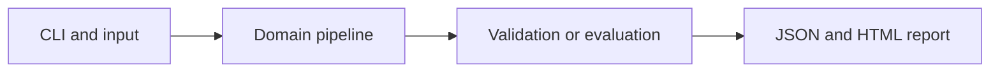

# Paired Multi-Omics Latent Alignment

Align fictional transcript and protein measurements using a regularized canonical-correlation projection.

**Category:** Biology / Representation Learning

**Execution:** Actual local algorithm or workflow; no external model service required.

## Run

```sh
python -m venv .venv
# Windows: .venv\Scripts\activate
# macOS/Linux: source .venv/bin/activate
python -m pip install -r requirements.txt
python app.py
python -m unittest discover -v
```

Open `results/report.html` after running. Python 3.10+ is required. Use `--help` for input and seed options.

## Architecture



## Algorithm

Center paired modalities, whiten each regularized covariance matrix, then perform SVD on cross-covariance. Project both modalities into a shared low-dimensional space.

## Evaluation

Fit on training pairs and retrieve the matching protein profile for held-out transcript profiles. Compare top-one retrieval with chance; paired test samples never fit the transform.

## Limitations

The pairing and shared factors are synthetic. This is linear CCA, not a multi-omics foundation model; matching scores are not biological interaction evidence.

## Documentation

- [PDF project guide](PROJECT_GUIDE.pdf)
- [Editable guide](GUIDE.md)
- [Model and system card](MODEL_CARD.md)
- [Measured results](results/metrics.json)
- [Test output](TEST_RESULTS.txt)

## Extend it

Evaluate real paired modalities with donor-held-out splits, missing modalities, nonlinear encoders and batch-aware baselines.

AI-assisted educational project with synthetic data. Review, customize and explain your own contribution accurately. MIT license.

## Biology scope and current relevance

Default inputs are synthetic or project-authored. No clinical deployment or wet-lab validation is claimed. See [research context](RESEARCH_CONTEXT.md) and [data provenance](DATA_PROVENANCE.md).

- [Universal cell embedding provides a foundation model for cell biology](https://www.nature.com/articles/s41586-026-10689-z) (2026)
